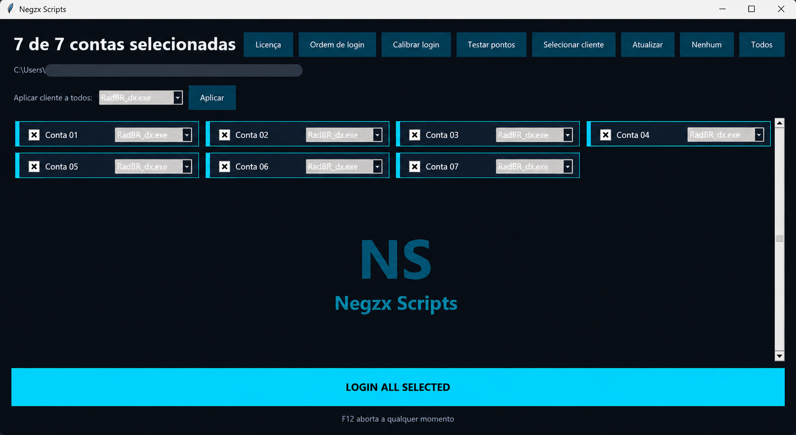

# Gerenciador de Instâncias — AutoLogin

### Automação de múltiplas contas com Python

Projeto de aplicação desktop desenvolvido para facilitar o gerenciamento de múltiplas instâncias de um cliente de jogo, automatizando processos repetitivos de abertura e autenticação de contas.

O sistema foi desenvolvido como parte dos projetos independentes da **NEGZ SCRIPTS**, com foco em automação, organização e praticidade.

## Funcionalidades

- Gerenciamento de múltiplas contas e instâncias.
- Automação do processo de login.
- Configurações personalizadas para execução.
- Sistema de licenciamento vinculado ao dispositivo.
- Validação de licenças por meio de uma API.
- Integração com banco de dados na nuvem.

## Tecnologias utilizadas

| Tecnologia | Aplicação |
|---|---|
| Python | Desenvolvimento da aplicação e automação |
| JavaScript | Implementação da API de validação |
| Cloudflare Workers | Execução da API |
| Cloudflare D1 | Armazenamento e consulta de licenças |
| SQL | Estruturação e manipulação do banco de dados |
| Git e GitHub | Versionamento e gerenciamento do projeto |

## Arquitetura do licenciamento

A aplicação envia uma solicitação HTTPS para uma API desenvolvida com Cloudflare Workers.

A API consulta o banco Cloudflare D1 para verificar a validade da licença e sua associação ao dispositivo.

O resultado da validação determina se a aplicação pode prosseguir com a operação autorizada.

## Aprendizados e desafios

Durante o desenvolvimento, trabalhei com:

- Integração entre aplicações desktop e serviços web.
- Desenvolvimento e consumo de APIs.
- Estruturação de banco de dados SQL.
- Tratamento de erros e validação de respostas.
- Identificação e correção de bugs.
- Automação de tarefas repetitivas.
- Versionamento de código com Git.

## Demonstração

### Interface principal

A aplicação permite selecionar e gerenciar múltiplas
contas, configurar a ordem de login e executar
processos automatizados.

### Vídeo de demonstração

https://github.com/user-attachments/assets/6cf27ab6-6483-46e4-b4ac-c4342149c3d8

## Código-fonte

O código-fonte completo é mantido em um repositório privado por se tratar de um projeto comercial independente.

---

**Desenvolvimento:** NEGZ SCRIPTS  
**Tipo:** Projeto independente de automação desktop
